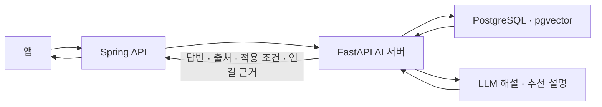

# 손끝 · Fingertip

**지역 장인의 기술과 이야기를 시민의 관심과 체험으로 연결합니다.**

전통문화에 관심이 생겨도, 그 기술을 이어가는 장인이 누구인지와 어디서 직접 배울 수 있는지를 찾아가는 과정은 따로 떨어져 있습니다.

손끝은 문화에 대한 궁금증을 장인과의 만남으로 이어가고자 합니다. 시민은 낯선 전통기술을 이해하고 참여할 체험을 찾으며, 장인은 자신의 기술과 작업 이야기를 소개하고 체험 참여자를 만나는 접점을 얻습니다.

무형유산을 이어가는 전승자와 지역 전통공예 장인을 연결 대상으로 지향합니다. 공식 보유자·전승교육사·이수자 등의 자격과 일반 장인의 활동 이력은 구분하며, 앱의 장인 승인 여부가 국가·지자체의 공식 인정을 의미하지는 않습니다.

## 관심에서 만남까지

“청자의 상감 기법을 직접 배워보고 싶어요.”

손끝이 지향하는 흐름은 다음과 같습니다.

1. 문화유산 자료를 바탕으로 상감 기법을 설명합니다.
2. 해당 기술과 연결된 장인·체험을 탐색합니다.
3. 지역·가격·시간·인원 조건에 맞는 후보를 찾습니다.
4. 추천 근거를 확인하고 체험 상세와 예약으로 이동합니다.

현재는 **도자기를 시범 분야**로 삼아 조건 검색과 문화·기술–체험 연결 구조를 구현하고 검증하고 있습니다. 실제 장인 데이터로 이 흐름 전체를 검증하는 작업은 남아 있습니다.

## 실행 화면

문화 해설은 관심 있는 기술을 이해하는 단계, 체험 탐색은 참여할 프로그램을 찾는 단계입니다. 아래 이미지는 팀 프로젝트의 실행 기록입니다.

| 문화 이해 · AI 해설 | 참여할 체험 탐색 |
| --- | --- |
|  |  |

서버는 출처와 연결 근거를 반환하지만, 위 AI 해설 화면에는 출처가 표시되지 않습니다. 새 조건 필터와 연결 근거를 표시하는 UI도 후속 작업입니다.

<details>
<summary>체험 상세 · 날짜 선택 · 예약과 장인 승인 화면</summary>


스크린샷은 당시 실행 상태의 기록이며 현재 배포 상태나 실제 결제·운영 실적을 의미하지 않습니다.

</details>

## 이 저장소의 역할

이 저장소는 손끝의 **Python AI 서버**입니다. 프로젝트에서 담당한 영역은 Python RAG와 Spring 백엔드 개발입니다.

| 역할 | 구현 내용 |
| --- | --- |
| 문화 이해 | 문화유산 자료 검색, LLM 해설 생성, 검색 출처 반환 |
| 체험 탐색 | 지역·가격·소요시간·인원 조건 적용 후 체험 벡터 검색 |
| 연결 근거 | 검토된 문화·기술–체험 직접 실습 관계와 근거 반환 |
| 후기 이해 | 후기 요약·감성 점수·키워드 반환 |

앱은 [Spring 메인 API](https://github.com/fingertip-app/backend)를 통해 AI 기능을 이용합니다. 인증·장인 관리·예약·결제는 Spring이 담당하며, Python은 내부 API로 검색·생성 결과를 반환합니다. 서버 간 인증 키는 앱에 전달하지 않습니다.



문화 해설과 체험 추천은 각각의 API입니다. 해설에서 얻은 문화 항목·기술을 추천 요청에 연결해 사용하는 구조이며, 단일 요청으로 예약까지 완료하는 기능은 아닙니다.

## 기술적 판단

### 문화 설명에는 검색 근거가 필요합니다

[문화 해설 RAG](app/services/ai/rag.py)는 질문을 임베딩해 pgvector로 후보 문서를 조회하고, 벡터 유사도와 키워드 점수를 결합해 순위를 정합니다. 선택한 문서를 LLM에 전달하고 문화유산의 ID·이름·출처·분류를 함께 반환합니다.

동일 문화유산에서 나온 청크 수를 제한해 긴 문서 하나가 검색 결과를 독점하는 현상을 줄입니다. 이 제한은 최초 벡터 후보 조회 후 적용하므로 후보에서 빠진 자료까지 복구하지는 않습니다. 검색 결과가 없으면 자료를 찾지 못했다는 안내와 빈 출처 목록을 반환합니다.

### 유사한 체험에도 필수 조건을 적용해야 합니다

[체험 검색](app/services/ai/experience_rag.py)은 지역·등록 가격 상한·소요시간 상한·최대 정원을 SQL에서 적용한 뒤 벡터 순위를 계산합니다. 지역을 질문에 덧붙이는 것만으로 조건이 충족됐다고 판단하지 않습니다.

자유문장에서는 일부 한국어 지역·가격 패턴을 추출하며, 구조화된 입력값이 우선합니다. 여러 지역이나 해석할 수 없는 예산은 확인 안내를 반환합니다. 전체 자연어 조건 해석과 날짜별 잔여석 확인은 아직 지원하지 않습니다.

### 문화적 연관과 직접 실습은 구분해야 합니다

문화·기술과 체험의 관계에 근거 URL·확인일·검토 상태를 저장합니다. 기술 또는 문화 항목을 명시한 추천 요청에서는 **검토 완료된 직접 실습 관계**가 있는 체험만 후보로 사용합니다.

추천 이유는 확인한 관계와 등록 정보로 작성합니다. 질문에 ‘가족’이 들어갔다는 이유만으로 가족에게 적합하다고 설명하던 규칙과, 청자·일반 도자 용어를 백자로 단정하던 매핑은 제거했습니다. 특정 회차의 진행자 자격과 예약 가능 여부는 별도 확인이 필요합니다.

AI 장애 시에도 Spring이 검증할 수 없는 자유문장·지역·기술 조건을 임의로 풀어 기본 체험으로 대체하지 않습니다.

[요청·응답 계약](docs/research/pottery-filter-contract.md) · [AI 라우터](app/api/v1/routers/ai.py) · [응답 스키마](app/schemas/ai.py)

## 검증 결과와 현재 한계

2026-10-18 로컬 변경 검증 결과입니다.

| 검증 | 결과 |
| --- | --- |
| Python 단위 테스트 | 95개 통과 |
| Spring 전체 테스트 | 78개 통과 |
| 실제 PostgreSQL 조건·관계 검사 | 합성 데이터 15개 사례 통과 |
| AI 마이그레이션 | 임시 DB에서 적용·새 리비전 되돌리기·재적용 성공 |
| 실제 임베딩·LLM·HTTP API | 합성 체험으로 조건 검색과 답변 반환 확인 |

테스트 통과는 실제 장인 추천의 정확도나 시민·장인의 이용 효과를 입증하지 않습니다. 출처 반환도 생성 문장 전체의 사실성을 보장하지 않습니다.

남은 검증 과제는 실제 장인·체험 관계와 최신 운영 정보 확인, 문장별 근거 정확성 평가, 날짜별 예약 연동 및 앱 전체 흐름 검증입니다. 다국어 답변 품질도 아직 검증하지 않았습니다.

공식 자료는 전국을 대상으로 조사 중이며, 현재 확보한 후보를 전국 수집 완료나 손끝 입점 상품으로 간주하지 않습니다. 합성 데이터는 로컬 검증용으로 구분합니다. 파일 기반 대체 응답을 사용하는 시연도 실시간 AI 생성 결과와 구분해야 합니다.

[PR 전 검증 기록](docs/research/pr-validation-2026-10-18.md) · [공식 자료 조사](docs/research/2026-10-18-pottery-pilot.md) · [후속 작업](docs/research/pottery-implementation-status.md)

## 개발 환경과 실행

Python 3.11+, FastAPI, Pydantic, SQLAlchemy, PostgreSQL + pgvector, OpenAI API를 사용합니다.

```bash
python3.11 -m venv .venv
source .venv/bin/activate
python -m pip install -e '.[dev]'
cp .env.example .env
```

`.env`에 `DATABASE_URL`, `OPENAI_API_KEY`, `INTERNAL_API_KEY`를 설정합니다. 키는 저장소에 커밋하지 않습니다. 단위 테스트에는 실제 모델 키가 필요하지 않습니다.

로컬 인프라는 이 저장소의 `docker compose up -d`로 실행하거나, 기존 Spring 인프라를 사용하는 [로컬 Docker DB 연결 안내](docs/local-docker-db.md)를 따릅니다. 두 Compose는 DB 이름·포트가 다르므로 선택한 환경과 `DATABASE_URL`을 맞춰야 합니다.

`experiences`의 기본 테이블과 체험 데이터는 Spring이 소유합니다. Python의 Alembic은 문화유산·벡터·연결 근거 테이블과 체험 임베딩 컬럼·검색 인덱스를 관리합니다. 새 DB에서는 Spring 기본 스키마를 먼저 준비한 뒤 실행합니다.

```bash
alembic upgrade head
uvicorn app.main:app --reload
```

이미 테이블이 있지만 Alembic 이력이 없는 DB는 먼저 스키마를 대조해야 합니다. 로컬 보완 도구를 운영 마이그레이션으로 사용하거나 이력을 임의로 등록하지 않습니다.

상태 확인과 단위 테스트:

```bash
curl http://localhost:8000/health
python -m pytest -q
```

### 내부 API 사용 예시

문화 해설을 호출하려면 DB에 문화유산 자료와 임베딩이 준비돼 있어야 합니다. 서버 환경에 `INTERNAL_API_KEY`를 설정한 뒤 호출합니다.

```bash
curl http://localhost:8000/api/v1/ai/explain \
  -H 'Content-Type: application/json' \
  -H "X-Internal-Api-Key: ${INTERNAL_API_KEY}" \
  -d '{"query":"도자기 만드는 전통 기술을 알려주세요","locale":"ko"}'
```

문화 해설은 `answer`, `sources`, `matchingKeywords`, `recommendedCategories`를 반환합니다. 체험 추천은 별도 `/api/v1/ai/recommendations`에서 적용 조건과 연결 근거를 반환합니다. 위 요청은 사용 예시이며 실행 결과 자체는 아닙니다.

실제 데이터가 준비된 환경에서는 [검색 스모크 테스트](docs/search-smoke-test.md)를 실행할 수 있습니다.
