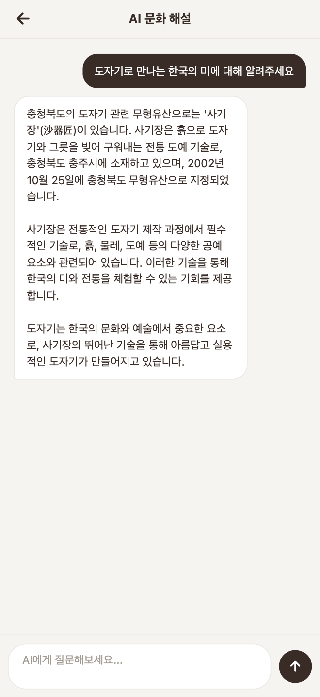
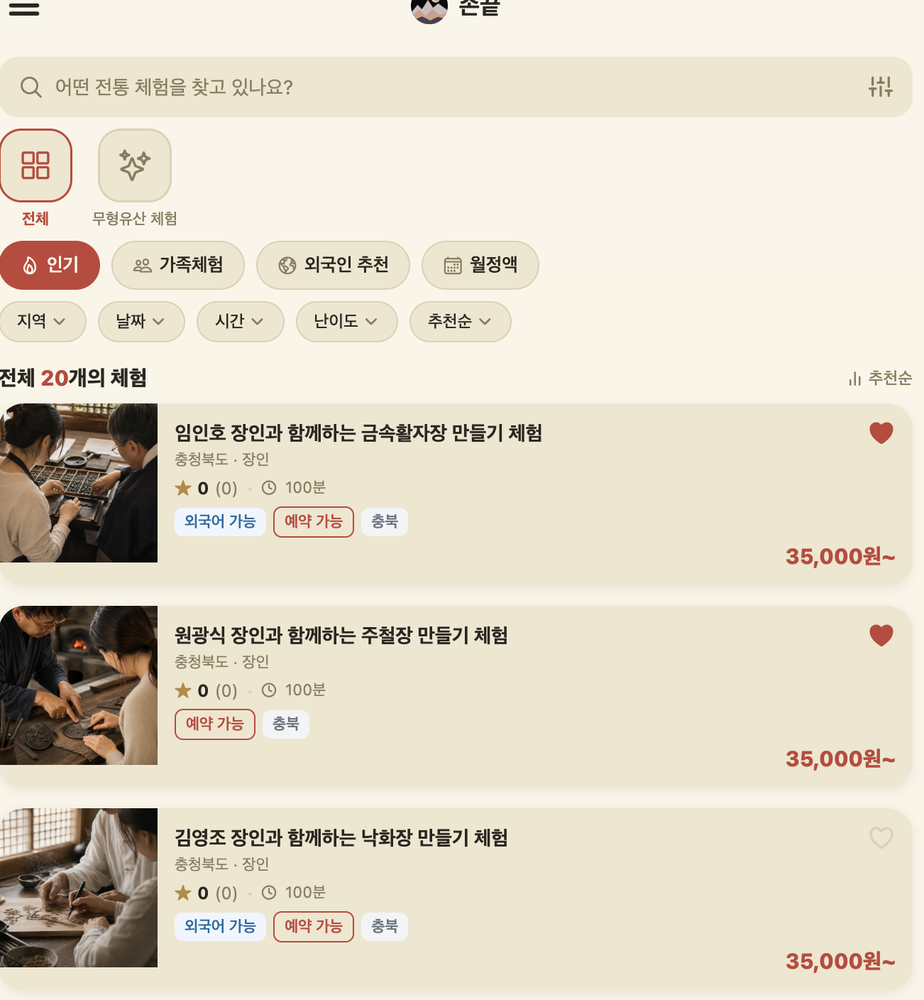
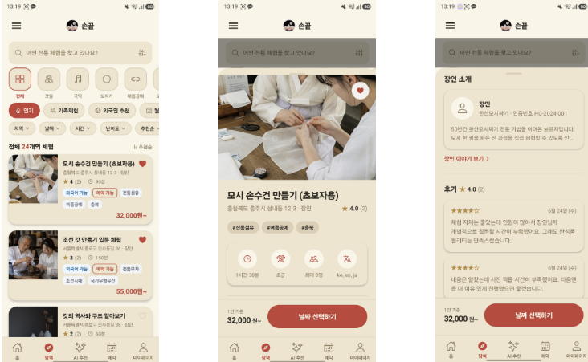
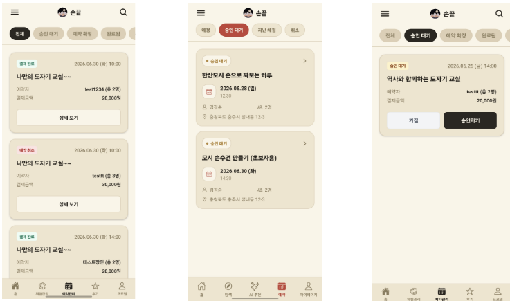
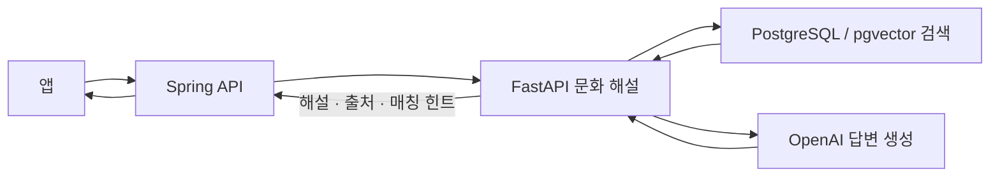

# 손끝 · Fingertip

**지역 장인의 기술과 이야기를 시민의 관심과 체험으로 잇는 전통문화 연결 서비스입니다.**

전통문화에 관심이 생겨도 어떤 장인이 그 기술을 이어가고 있는지, 어디에서 직접 경험할 수 있는지까지 알아보려면 여러 정보를 찾아야 합니다. 손끝은 이 탐색 과정을 문화에 대한 질문에서 장인과의 만남으로 이어지는 하나의 흐름으로 만들고자 합니다.

시민에게는 낯선 전통기술을 이해하고 자신의 관심에 맞는 체험을 발견하는 접점을, 지역 장인에게는 기술의 가치와 작업 이야기를 시민에게 전하는 접점을 제공하는 것이 목표입니다. 무형유산을 이어가는 장인과 지역 전통공예 장인을 연결 대상으로 지향하며, 공식 지정·인정 여부는 개별 장인의 확인 가능한 정보로 구분해야 합니다.

예를 들어 “드라마에서 본 노리개는 어떻게 만들까?”라는 관심이 생기면, 관련 문화 해설을 읽고 매듭 공예 체험을 탐색한 뒤 장인과의 체험을 예약하는 흐름을 지향합니다. 이는 서비스 사용 시나리오이며, 해당 질문의 검색·예약 성공을 검증한 결과는 아닙니다.

## AI가 연결을 돕는 방식

AI의 역할은 문화 지식을 설명하는 데서 끝나지 않고, **문화에 대한 관심을 실제 장인 체험을 찾는 단서로 바꾸는 것**입니다.

| 단계 | 연결하는 정보 | 이 저장소의 현재 역할 |
| --- | --- | --- |
| 이해 | 시민의 질문 → 전통문화의 배경과 기술 | 문화유산 자료 검색과 LLM 해설 생성 |
| 탐색 | 문화·기술 → 관련 체험 | 매칭 키워드·카테고리 반환, 체험 벡터 검색과 추천 설명 생성 |
| 만남 | 체험 선택 → 예약과 장인 승인 | Spring 메인 API가 담당하며, 앱 전체 연동 검증은 별도 |

현재 문화 해설과 체험 추천 서비스는 각각 구현되어 있습니다. 특정 문화유산·전승 기술·장인·체험을 명시적인 관계로 연결하고, 날짜·거리·예산·잔여석까지 반영하는 추천은 추가 고도화 과제입니다. 이러한 기능의 구현이나 연결 효과를 현재 성과로 주장하지 않습니다.

이 저장소는 **Python AI 서버**입니다. 프로젝트에서 담당한 영역은 **Python RAG와 Spring 백엔드 개발**입니다.
[Spring 백엔드 저장소](https://github.com/fingertip-app/backend) · [검색 검증 절차](docs/search-smoke-test.md)

## 실행 화면

팀 프로젝트의 실행 화면입니다. 아래 화면은 제품 맥락을 보여주며, 이 저장소는 AI 서버 구현을 담고 있습니다.

| AI 문화 해설 | 체험 탐색 |
| --- | --- |
|  |  |

AI 해설 화면에는 출처가 표시되지 않습니다. 서버의 출처 반환 구조는 [응답 스키마](app/schemas/ai.py)에서 확인할 수 있습니다.

<details>
<summary>체험 상세와 예약 관리 화면</summary>

### 체험 탐색에서 날짜 선택까지



### 사용자 예약과 장인 승인 화면



스크린샷은 당시 실행 상태의 기록이며, 현재 배포 상태나 실제 결제·운영 실적을 의미하지 않습니다.

</details>

## 구현과 설계 판단

### 문화유산 문서 검색

[CultureRagService](app/services/ai/rag.py)는 질문을 임베딩하고 pgvector로 후보 문서를 조회합니다.
벡터 유사도와 키워드 점수를 결합해 순위를 정하고, 선택한 문서를 답변 생성의 문맥으로 전달합니다.
의미 유사성과 문화유산 관련 어휘를 함께 반영하는 구조입니다. 검색 품질의 개선 폭은 별도 평가가 필요합니다.

### 긴 문서의 검색 결과 독점 제한

동일 문화유산에서 나온 청크 수를 제한해 특정 항목이 후보를 과도하게 차지하지 않도록 처리합니다.
현재 구현에서는 벡터 후보 조회 후 이 제한을 적용하므로, 최초 후보 목록에서 제외된 항목까지 복구하는 것은 아닙니다.

### 근거 반환과 검색 실패 처리

검색한 문화유산의 ID·이름·출처·분류를 반환하고, 같은 항목의 출처는 중복 제거합니다.
검색 결과가 없으면 자료를 찾지 못했다는 안내와 빈 출처 목록을 반환합니다.
출처 반환은 생성 문장 전체의 사실성을 보장하지 않으며, 답변 품질 검증은 별도로 필요합니다.

## 문화 해설 요청 흐름



Python 서버는 문화 해설과 검색 근거를 반환합니다. Spring과 연결할 때는 서버 간 인증 헤더를 사용합니다.
앱은 내부 API 키를 보유하지 않는 구조입니다.

- [AI 라우터](app/api/v1/routers/ai.py)
- [문화 해설 RAG](app/services/ai/rag.py)
- [응답 스키마](app/schemas/ai.py)
- [후기 요약 서비스](app/services/ai/review_summary.py)

## API 사용

문화 해설 요청 예시입니다. 실행 전 DB에 문화유산 자료와 임베딩이 준비돼 있어야 합니다.

```bash
set -a; source .env; set +a
curl http://localhost:8000/api/v1/ai/explain \
  -H 'Content-Type: application/json' \
  -H "X-Internal-Api-Key: ${INTERNAL_API_KEY}" \
  -d '{"query":"도자기 만드는 전통 기술을 알려주세요","locale":"ko"}'
```

| 응답 필드 | 역할 |
| --- | --- |
| `answer` | 문화 해설 또는 검색 결과 없음 안내 |
| `sources` | 검색에 사용한 문화유산의 ID·이름·출처·분류 |
| `matchingKeywords` | 관련 체험 매칭에 사용하는 키워드 |
| `recommendedCategories` | 관련 체험 매칭에 사용하는 카테고리 |

위 요청은 사용 예시이며, 실제 실행 결과를 기록한 것은 아닙니다.

## 현재 상태와 검증

### 도자기 연결 AI 시범

도자기를 첫 시범 분야로 정하고 전국 자료를 수집한 뒤 지역 조건으로 탐색하는 방향을 검토하고 있습니다. [공식 자료 조사](docs/research/2026-10-18-pottery-pilot.md)와 [구현·검증 상태](docs/research/pottery-implementation-status.md)에 확인된 정보와 미확인 항목을 기록합니다. 전국 수집 완료나 외부 체험의 손끝 입점을 의미하지 않습니다.

2026-10-18 로컬 수정에서는 일반 도자 용어를 백자로 단정하는 매핑과 질문만으로 참여 적합성을 생성하는 규칙을 제거했습니다. 지역·가격·시간·인원 조건을 검색 전에 적용하고, 검토된 문화·기술 연결 근거로 직접 실습 후보를 제한하는 구조를 추가했습니다. Spring까지 조건과 연결 근거를 전달합니다. [요청·응답 계약과 검증 범위](docs/research/pottery-filter-contract.md)를 확인할 수 있습니다.

Python 단위 테스트 **95개**, 로컬 PostgreSQL 합성 데이터 조건 검증 **15개**를 통과했습니다. 실제 모델·DB·FastAPI HTTP 호출도 합성 자료로 연결 확인했습니다. 실제 장인 데이터의 추천 품질·예약 가능 여부·전체 앱 화면은 이 검증 범위에 포함되지 않습니다. [PR 전 검증 기록](docs/research/pr-validation-2026-10-18.md)에 Spring 전체 테스트와 마이그레이션 검사 결과를 남겼습니다.

2026-10-17 로컬 점검에서 `python -m pytest -q`는 **65개 통과**했습니다.

테스트 범위는 `pyproject.toml`에서 `tests/`로 지정해 DB 연결을 전제로 하는 실험 스크립트를 자동 수집하지 않습니다.
`experiences`의 기본 테이블과 체험 데이터는 Spring이 소유합니다. Python은 AI 추천 검색에 필요한 체험 필드를 SQLAlchemy로 매핑하고, Alembic 기준 마이그레이션은 AI 전용 문화유산·벡터 테이블을 생성합니다. 후속 AI 마이그레이션은 이미 존재하는 Spring 체험 테이블에 `description_embedding` 컬럼과 검색 인덱스만 추가합니다. 따라서 빈 DB에서는 Spring 기본 스키마를 먼저 준비해야 합니다.

실제 DB·모델을 연결한 검색 품질과 앱 전체 흐름은 이번 점검에서 검증하지 않았습니다.

### 시연과 한계

- `AI_FALLBACK_ENABLED=true`이면 일부 AI 오류에 파일 기반 대체 응답을 사용할 수 있습니다. 실시간 생성 결과와 구분해서 평가해야 합니다.
- `locale` 입력을 받지만 해외 사용자 대상 유용성이나 다국어 답변 품질은 검증 결과가 없습니다.
- 다음 검증 과제는 해외 방문객의 질문으로 문화 해설과 체험 탐색이 실제로 도움이 되는지 확인하는 것입니다.

## 개발 환경

Python 3.11+, FastAPI, Pydantic, SQLAlchemy, PostgreSQL + pgvector, OpenAI API를 사용합니다.

1. Python 3.11 가상환경을 만들고 개발 의존성을 설치합니다: `python3.11 -m venv .venv && source .venv/bin/activate && python -m pip install -e '.[dev]'`.
2. `.env.example`을 `.env`로 복사합니다: `cp .env.example .env`. 로컬 테스트만 실행할 때는 키를 비워둘 수 있지만, 실제 AI 요청에는 `OPENAI_API_KEY`와 내부 호출용 `INTERNAL_API_KEY`를 설정해야 합니다.
3. `DATABASE_URL`, `OPENAI_API_KEY`, `INTERNAL_API_KEY`를 설정합니다. 키는 저장소에 커밋하지 않습니다.
4. 로컬 인프라가 필요하면 이 저장소의 `docker compose up -d`로 PostgreSQL과 Redis를 실행합니다. 기존 서비스가 같은 포트를 사용 중인지 확인하세요.
5. Spring이 소유한 기본 테이블을 먼저 준비한 DB에서 `alembic upgrade head`를 실행합니다. 마지막 Alembic 마이그레이션은 Spring이 생성하는 `experiences` 테이블에 임베딩 컬럼을 추가하므로 빈 DB에 단독 적용할 수 없습니다.
6. 문화유산 자료·임베딩을 준비한 뒤 `uvicorn app.main:app --reload`로 서버를 시작합니다.

```bash
curl http://localhost:8000/health
python -m pytest -q
```

실제 데이터가 준비된 환경에서는 [검색 스모크 테스트](docs/search-smoke-test.md)를 실행할 수 있습니다.
